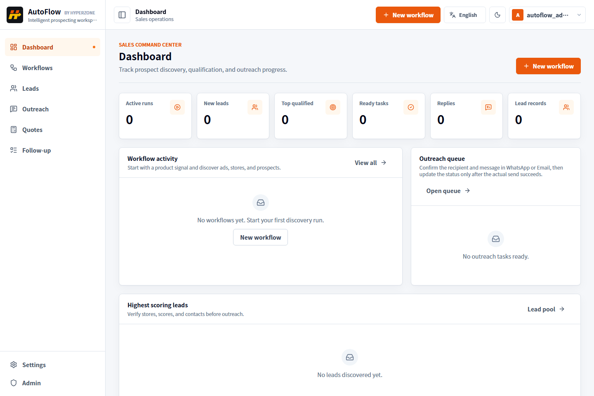
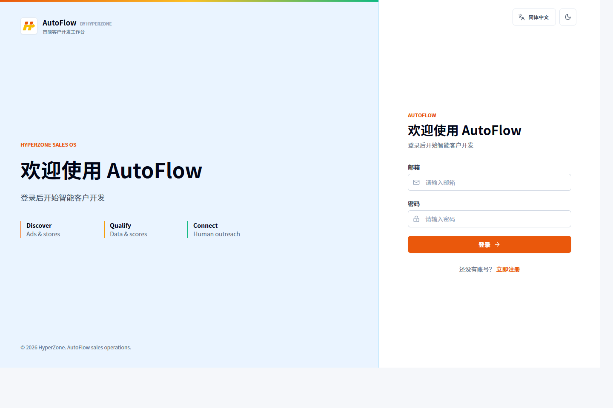
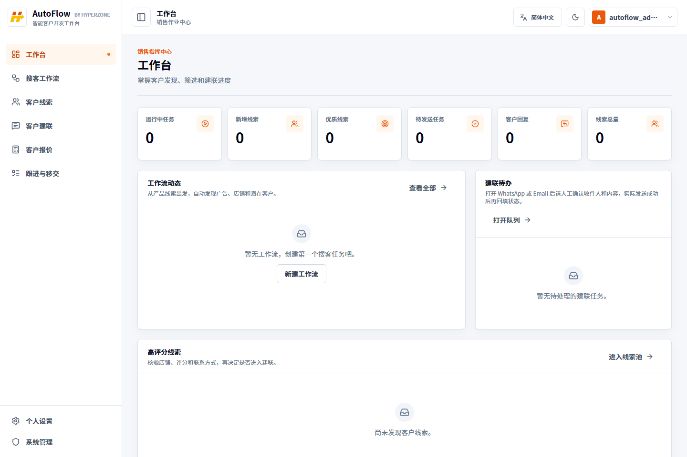
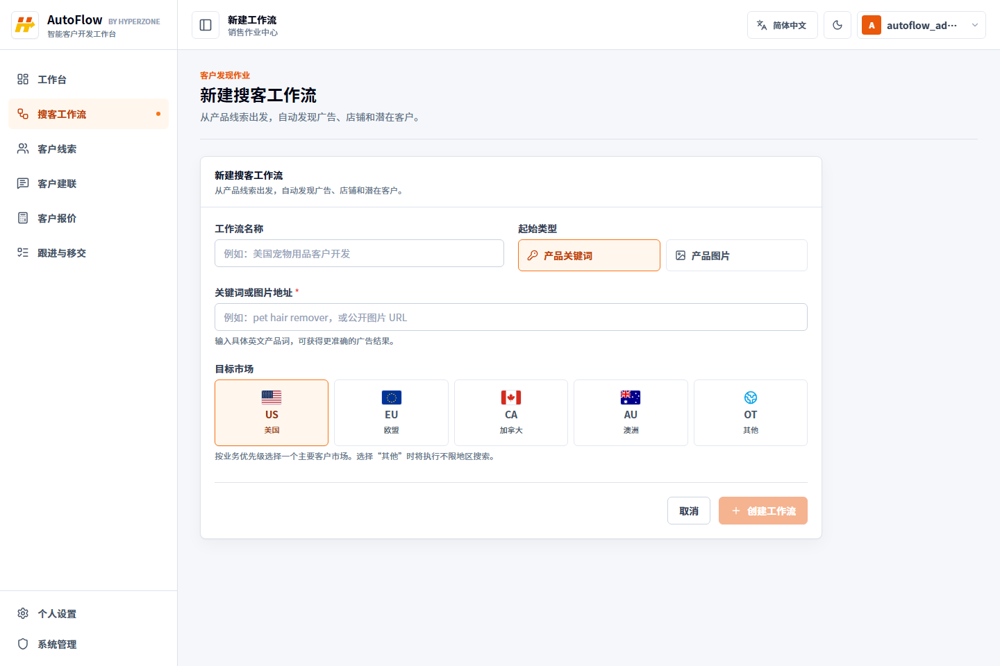
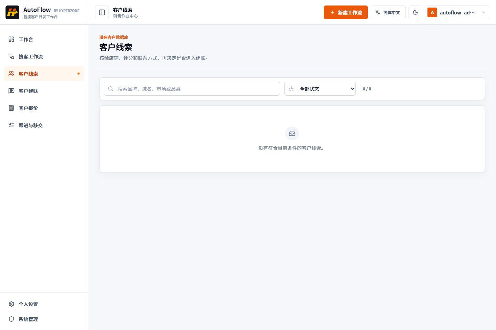
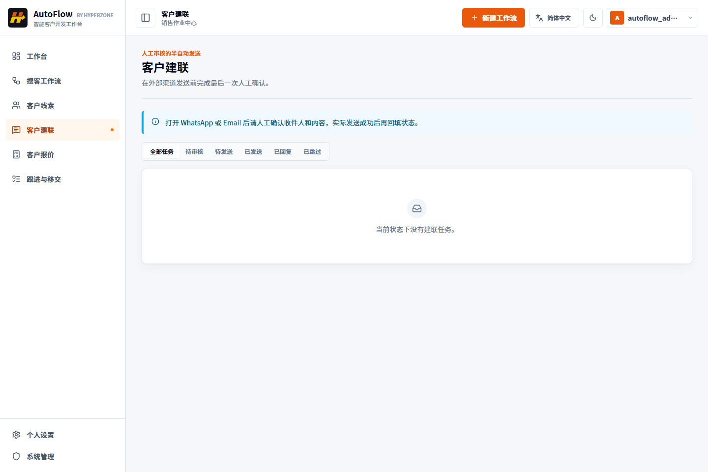
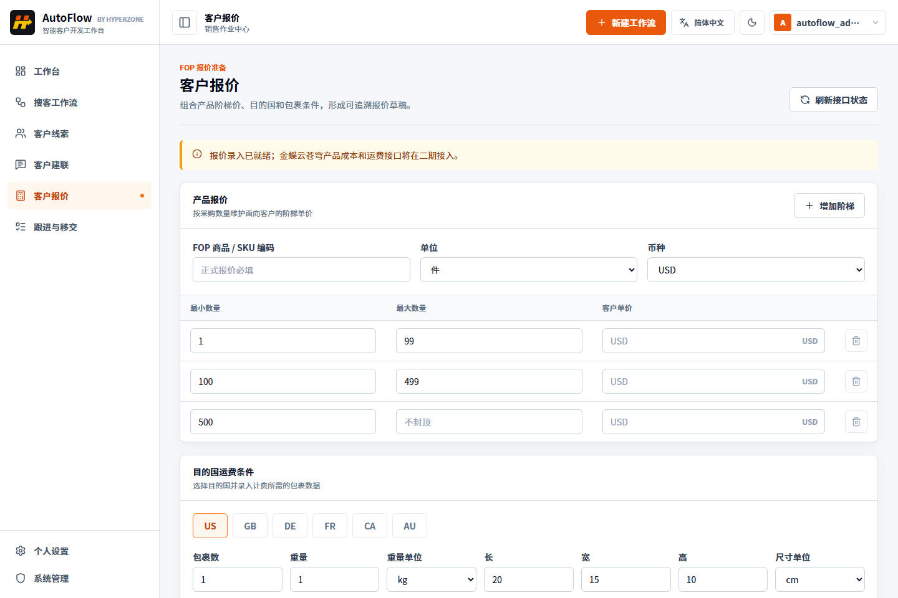
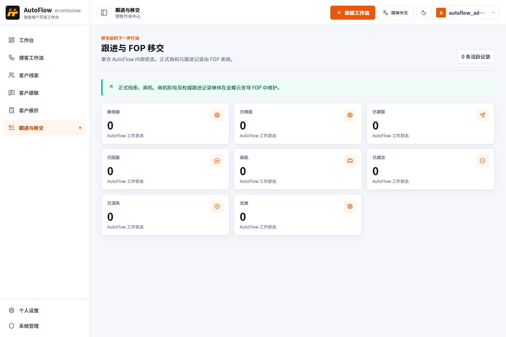
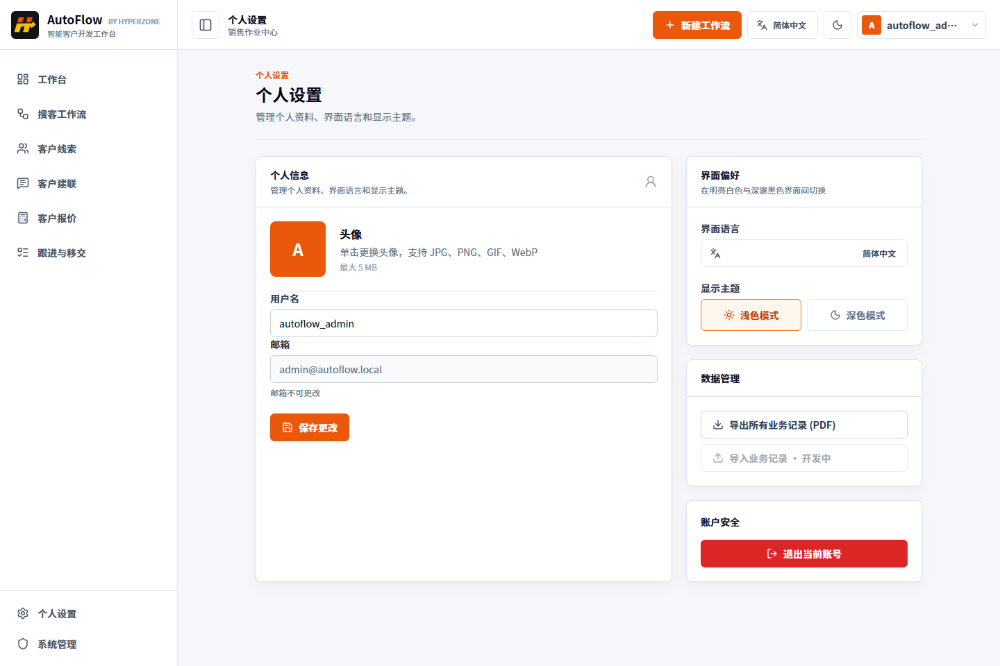
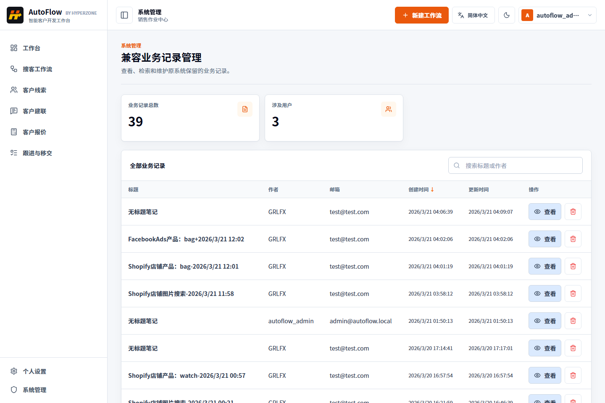

# AutoFlow 系统操作手册

> 文档版本：V1.0
> 适用版本：AutoFlow 第一阶段开发版本
> 更新日期：2026-07-22
> 适用对象：外贸销售员、销售主管、系统管理员、测试与验收人员

## 1. 手册说明

AutoFlow 是面向 Dropshipping 海外小 B 客户开发场景的销售作业工具。当前版本重点支持以下工作：

1. 用产品关键词或产品图片地址创建搜客工作流。
2. 通过广告数据发现潜在商品和店铺，并识别 Shopify 店铺。
3. 清洗客户数据，展示客户评分、联系人及证据来源。
4. 使用智谱 GLM 生成客户开发话术，由业务员人工审核。
5. 通过 WhatsApp、Email 等外部渠道半自动建联，并回填发送与回复状态。
6. 创建包含数量阶梯、目的国和包裹信息的报价草稿。
7. 为后续对接金蝶云苍穹 FOP 的线索、商机和报价能力保留入口。

当前系统的推荐主流程为：

```text
产品关键词或图片
→ 创建并启动搜客工作流
→ PipiAds 广告发现
→ Shopify 店铺识别
→ 数据清洗与线索评分
→ 核验联系方式
→ 智谱 GLM 生成话术
→ 人工审核
→ WhatsApp / Email 建联
→ 标记发送及回复
→ 报价准备
→ 后续移交 FOP
```

### 1.1 当前能力边界

| 能力 | 当前状态 | 操作说明 |
|---|---|---|
| 登录、注册、权限控制 | 可用 | 普通用户与管理员权限分离 |
| 关键词搜客工作流 | 已实现 | 执行依赖 PipiAds 可用额度 |
| 图片搜客工作流 | 已提供入口 | `Seed value` 当前填写可公开访问的图片 URL |
| Shopify 识别与线索评分 | 已实现 | 结果质量取决于外部数据源及可验证证据 |
| AI 开发话术 | 已实现 | 依赖智谱 GLM API Key 和账户额度 |
| 半自动建联 | 可用 | 系统打开外部渠道，发送动作由业务员完成 |
| 报价草稿 | 可用 | 可保存版本化草稿，不等于已经取得 FOP 实时报价 |
| FOP 产品成本、运费试算 | 二期预留 | 当前未实现真实适配器，按钮将保持不可用 |
| FOP 线索、商机和正式跟进 | 二期预留 | FOP 是后续正式业务记录的权威系统 |
| 导入业务记录 | 开发中 | 当前按钮不可用 |

> 验收注意：界面中出现 FOP 入口表示契约和交互位置已经预留，不表示金蝶云苍穹接口已经完成联调。

## 2. 使用前准备

### 2.1 访问要求

- 推荐浏览器：最新版 Microsoft Edge 或 Google Chrome。
- 本地验收地址：`http://127.0.0.1:5173`。
- 后端服务地址：`http://127.0.0.1:3000`。
- 使用前应确认前端、后端和 PostgreSQL 数据库均已启动。
- 账号由系统管理员分配；请勿在聊天记录、截图或公共文档中保存密码。

### 2.2 外部服务要求

完成整条搜客与 AI 话术链路，还需要：

- PipiAds API Key 有效且账户存在足够 API credits。
- 智谱 BigModel API Key 有效，且账户存在可调用 `glm-5.2` 的余额或资源包。
- 外部目标网站和联系方式链接能从当前网络正常访问。

API Key 仅配置在后端本地环境文件中，不需要也不允许业务员在浏览器页面填写。

### 2.3 界面语言与显示主题

AutoFlow 支持简体中文和英文两种操作界面。首次访问默认使用简体中文和白色主题，选择结果保存在当前浏览器中。

1. 单击页面右上角的语言选择器。
2. 选择“简体中文”或 `English`，页面文案会立即切换，不需要重新登录。
3. 单击语言选择器右侧的月亮或太阳图标，可以在白色主题与黑色主题之间切换。
4. 也可以进入“个人设置 → 界面偏好”，统一修改界面语言和显示主题。

英文界面示例：



为确保屏幕阅读和打印清晰度，本手册全部操作截图统一使用浅色主题。系统仍支持深色主题，可通过顶部主题按钮随时切换。

移动端界面会自动隐藏左侧导航。单击顶部左侧导航按钮可以打开菜单，再次单击灰色遮罩即可关闭：


## 3. 登录、注册与退出

### 3.1 登录

打开系统后进入登录页：



操作步骤：

1. 在“邮箱”中输入已分配的登录邮箱。
2. 在“密码”中输入密码。
3. 单击“登录”。
4. 登录成功后，系统自动进入 Dashboard。

常见提示：

- “请输入邮箱和密码”：有必填项未填写。
- “登录失败，请检查邮箱和密码”：账号不存在、密码错误或后端不可用。
- 登录后又返回登录页：登录会话可能已失效，请重新登录。

### 3.2 注册普通账号

如果系统允许自助注册，可在登录页单击“立即注册”：

1. 输入有效邮箱，单击“发送验证码”。
2. 输入收到的 6 位验证码。
3. 输入用户名。
4. 设置不少于 10 位的密码，并再次确认。
5. 单击“注册”。

开发环境可能直接弹出验证码；生产环境应通过已配置的邮件服务发送。新注册账号默认为普通用户，不自动获得管理员权限。

### 3.3 退出登录

有两种退出方式：

1. 单击页面右上角头像，再单击 `Sign out`。
2. 进入左侧 `Settings`，在页面底部单击“退出登录”。

在公共电脑上结束作业后必须退出登录。

## 4. 工作台与全局导航

登录后的主界面如下：



### 4.1 左侧菜单

| 菜单 | 中文含义 | 主要用途 |
|---|---|---|
| `Dashboard` | 工作台 | 查看业务概览和待办 |
| `Workflows` | 搜客工作流 | 创建、启动、重试和查看搜客任务 |
| `Leads` | 线索池 | 搜索、筛选并查看潜在客户 |
| `Outreach` | 建联任务 | 审核、发送并跟踪开发话术 |
| `Quotes` | 报价工作区 | 准备产品阶梯价和目的国运费条件 |
| `Follow-up` | 跟进与移交 | 查看 AutoFlow 跟进状态及 FOP 移交边界 |
| `Settings` | 设置 | 修改个人信息、主题和导出记录 |
| `Admin` | 管理员面板 | 仅管理员可见，管理兼容层业务记录 |

简体中文界面中菜单会直接显示为“工作台、搜客工作流、客户线索、客户建联、客户报价、跟进与移交”；切换英文后显示表格中的英文名称。

单击左上角侧栏图标可以收起或展开左侧菜单。页面右上角的 `New workflow` 可从任意业务页面快速新建工作流。

### 4.2 Dashboard 指标

工作台主要指标包括：

- `Active runs`：正在运行的搜客工作流数。
- `New leads`：新进入线索池的客户数。
- `Top qualified`：当前高质量线索数。
- `Ready tasks`：已审核、等待业务员发送的建联任务数。
- `Replies`：已回填为收到回复的客户数。
- `Lead records`：当前用户可见的线索总数。

下方区域用于查看工作流活动、待发送建联任务及高评分线索。单击线索可进入详情页。

## 5. 创建和执行搜客工作流

### 5.1 新建工作流

单击右上角 `New workflow`，或进入 `Workflows` 后单击同名按钮：



字段说明：

| 字段 | 是否必填 | 填写建议 |
|---|---|---|
| `Workflow name` | 否 | 建议填写“市场 + 品类 + 日期”，例如 `US Pet Tools 2026-07-22` |
| `Seed type` | 是 | `Keyword` 为关键词；`Image` 为产品图片 |
| `Seed value` | 是 | 关键词或可公开访问的图片 URL |
| `Target market` | 是 | 从 `US / EU / CA / AU / OT` 国家卡片中单选；`OT` 表示不限地区搜索 |

关键词工作流示例：

```text
Workflow name: US Pet Hair Remover
Seed type: Keyword
Seed value: pet hair remover
Target market: United States
```

图片工作流示例：

```text
Workflow name: UK Image Prospecting
Seed type: Image
Seed value: https://example.com/product-image.jpg
Target market: United Kingdom
```

确认后单击 `Create`。系统只创建工作流定义，此时还没有执行外部数据发现。

### 5.2 启动工作流

进入 `Workflows`：


1. 找到状态为 `draft` 的工作流。
2. 核对名称、种子、目标市场。
3. 单击操作列中的 `Start`。
4. 状态变为 `running` 后等待系统执行。
5. 页面会轮询最新进度；完成后状态变为 `completed`。
6. 如果状态为 `failed`，先排查错误，再单击 `Retry`。

工作流状态：

| 状态 | 含义 | 建议动作 |
|---|---|---|
| `draft` | 已创建，尚未执行 | 核对参数后单击 `Start` |
| `running` | 正在执行 | 等待完成，不要重复提交 |
| `completed` | 执行完成 | 前往 `Leads` 查看结果 |
| `failed` | 执行失败 | 检查额度、网络和服务日志后重试 |
| `cancelled` | 已取消 | 根据需要重新创建工作流 |

### 5.3 外部额度不足时的处理

当前验收环境已验证过两类真实外部错误：

- PipiAds 返回 `442`：API credits 不足。
- 智谱 GLM 返回 `1113`：账户余额或资源包不足。

发生上述错误时，AutoFlow 会将真实调用判定为失败，不会使用伪造数据冒充成功结果。充值或补充资源包后，再回到工作流列表单击 `Retry`。

## 6. 线索池与客户核验

进入左侧 `Leads`：



### 6.1 搜索与筛选

- 搜索框支持按品牌名、店铺域名和市场搜索。
- 状态筛选支持 `New`、`Qualified`、`Contacted`、`Replied`、`Opportunity`、`Won`、`Lost`。
- 默认按系统返回顺序展示，优先处理高总分且联系方式证据完整的线索。

### 6.2 列表字段

| 字段 | 含义 |
|---|---|
| Lead | 品牌或店铺名称、域名 |
| Market / Language | 目标国家或市场、主要语言 |
| Category | 商品或店铺品类 |
| Scores | Shopify、广告活跃度、流量、联系人等评分 |
| Angle | 推荐开发切入点 |
| Status | 线索当前业务状态 |

评分用于排序和辅助判断，不应代替业务员核验。特别是邮箱、WhatsApp、社媒账号等联系方式，应优先查看证据来源和验证状态。

### 6.3 线索详情

单击某条线索后进入详情页，可查看：

- 店铺域名和外部店铺链接。
- 总分与 Shopify、广告、流量、联系人子评分。
- 系统推荐的开发切入点。
- 联系方式类型、内容、验证状态、置信度和 `Evidence source`。
- AI 开发话术区域。
- 报价准备和 FOP 移交入口。

联系人建议核验顺序：

1. 单击 `Evidence source` 检查来源页面是否仍然有效。
2. 确认联系方式确实属于目标店铺，而不是广告代理、平台客服或第三方网站。
3. 优先使用 `verified` 或高置信度联系方式。
4. 发现无效信息时不要发送，避免影响域名信誉和渠道账号安全。

线索状态含义：

| 状态 | 含义 |
|---|---|
| `new` | 新发现，尚未完成业务筛选 |
| `qualified` | 符合目标客户条件 |
| `contacted` | 已完成首次建联 |
| `replied` | 客户已有回复 |
| `opportunity` | 已形成明确销售机会 |
| `won` | 已成交 |
| `lost` | 已确认流失 |
| `invalid` | 数据无效或不应继续跟进 |

## 7. AI 话术生成与人工审核

在客户详情页右侧 `AI outreach draft` 区域操作：

1. 确认客户评分、品类和联系方式证据。
2. 单击 `Generate draft`。
3. 系统调用智谱 GLM 生成话术，并将内容填入文本框。
4. 业务员必须检查客户称呼、产品匹配度、语言、承诺、价格和合规风险。
5. 直接在文本框中修改内容。
6. 确认可发送后单击 `Approve for outreach`。
7. 任务状态由 `draft` 变为 `ready`，并进入 `Outreach` 队列。

人工审核要求：

- 不发送 AI 虚构的价格、库存、物流时效和合作案例。
- 不把未经验证的店铺信息写成确定事实。
- 不包含 API Key、系统内部信息或其他客户数据。
- 根据客户所在国家和语言调整表达。
- 保持首次触达简短，并提供明确回复入口。

如果提示 AI 不可用，先确认智谱 API Key、模型权限、余额或资源包；不要反复快速点击生成按钮。

## 8. 半自动客户建联

进入左侧 `Outreach`：



### 8.1 建联状态与按钮

| 状态 | 页面操作 | 含义 |
|---|---|---|
| `draft` | `Approve`、`Skip` | 话术草稿仍需审核 |
| `ready` | `Open WhatsApp/Email`、`Mark sent`、`Skip` | 已批准，等待人工发送 |
| `sent` | `Mark replied` | 已在外部渠道发送 |
| `replied` | 无发送按钮 | 客户已回复，应进入资格判断或报价 |
| `failed` | `Retry`、`Skip` | 任务失败，可修正后重试 |
| `skipped` | 无主操作 | 已跳过，不继续发送 |

### 8.2 推荐发送流程

1. 使用状态筛选选择 `Ready`。
2. 再次检查任务中的渠道、目标联系人、主题和消息正文。
3. 单击 `Open WhatsApp` 或对应外部渠道按钮。
4. 在外部页面确认收件人和消息内容，再人工执行发送。
5. 返回 AutoFlow，单击 `Mark sent`。
6. 收到客户回复后，单击 `Mark replied`。

> `Mark sent` 只是业务状态回填，不会代替 WhatsApp 或 Email 的真实发送。必须确认外部渠道已经发送成功后再点击。

## 9. 报价工作区

从左侧 `Quotes` 进入，或在线索详情单击 `Prepare quote`：



### 9.1 产品报价条件

1. 在 `FOP product / SKU reference` 输入商品或 SKU 参考编码。
2. 在 `Unit` 选择单位：`Piece`、`Set` 或 `Carton`。
3. 在 `Currency` 选择 `USD`、`EUR` 或 `GBP`。
4. 为每个数量阶梯填写最小数量、最大数量和客户单价。
5. 单击 `Add tier` 增加阶梯；单击删除图标移除不需要的阶梯。

阶梯必须满足：

- 最小数量为大于或等于 1 的整数。
- 最大数量不得小于最小数量。
- 相邻阶梯不能重叠。
- 除最后一个阶梯外，其余阶梯应填写最大数量。
- 每个阶梯的客户单价必须大于 0。

### 9.2 目的国运费条件

1. 勾选一个或多个目的国。目前页面提供 `US`、`GB`、`DE`、`FR`、`CA`、`AU`。
2. 填写包裹数量、重量和重量单位。
3. 填写长、宽、高及尺寸单位。
4. 检查下方 `Combined quote matrix`，确认每个数量阶梯与目的国组合均已生成。

### 9.3 保存报价草稿

填写所有必填条件后，单击 `Save draft`：

- 首次保存创建报价草稿版本 1。
- 再次保存创建新版本，不覆盖历史版本。
- 保存成功只表示报价条件已固化，不表示已经取得 FOP 产品成本或物流运费。

当前页面顶部显示黄色提示，且 `Request FOP quote` 不可用，表示金蝶云苍穹产品成本与物流运费适配器尚未实现。正式报价前不得把 `Pending FOP` 或空白运费当作客户价格。

## 10. 跟进状态与 FOP 移交

进入左侧 `Follow-up`：



页面汇总 AutoFlow 内部的 `Qualified`、`Contacted`、`Replied`、`Opportunity`、`Won`、`Lost` 等状态数量，用于在正式移交前快速查看业务进度。

当前阶段的职责边界：

- AutoFlow 负责搜品、搜店铺、筛查联系方式、客户评分、AI 话术、半自动建联和报价条件准备。
- FOP 后续负责正式线索、商机、商机阶段、权威跟进记录、产品成本和物流运费试算。
- `Handoff to FOP` 是预留入口；FOP 适配器不可用时，不应认为移交已成功。
- 正式上线后，应以 FOP 返回的线索 ID、商机 ID 和同步状态作为移交成功依据。

## 11. 个人设置与数据导出

进入左侧 `Settings`：



### 11.1 修改个人信息

- 用户名：可修改，不能为空，修改后单击“保存更改”。
- 邮箱：当前不可修改。
- 头像：单击头像上传，支持 JPG、JPEG、PNG、GIF、WebP，文件最大 5 MB。

### 11.2 深色模式

使用“深色模式”开关切换浅色或深色主题。选择结果保存在当前浏览器中。

### 11.3 数据管理

- “导出所有业务记录 (PDF)”用于导出当前兼容层中的业务记录。
- 没有业务记录时，系统会提示“没有业务记录可导出”。
- “导入业务记录”仍在开发中，按钮当前不可用。

这里的“业务记录”来自原系统兼容模块，不等同于 AutoFlow 线索池、工作流或 FOP 正式业务数据。

## 12. 管理员操作

只有管理员能看到左侧 `Admin` 菜单：



管理员面板当前用于管理原系统兼容层业务记录：

- 查看业务记录总数和涉及用户数量。
- 按标题或作者搜索。
- 单击标题、作者、邮箱、创建时间、更新时间表头排序。
- 单击“查看”预览经过安全过滤的记录内容。
- 单击“删除”并二次确认后删除记录。

删除操作不可恢复。管理员应先确认记录归属和业务保留要求，不得将该页面误用为用户管理、线索管理或 FOP 数据管理入口。

## 13. 三个典型作业流程

### 13.1 关键词开发客户

1. 在 `New workflow` 选择 `Keyword`。
2. 输入具体产品关键词和目标市场。
3. 创建后在 `Workflows` 单击 `Start`。
4. 完成后进入 `Leads`，筛选高分线索。
5. 打开客户详情，核验店铺和联系方式证据。
6. 单击 `Generate draft`，修改并批准话术。
7. 在 `Outreach` 打开外部渠道并人工发送。
8. 回填 `Mark sent`；收到回复后回填 `Mark replied`。
9. 有报价意向时进入 `Prepare quote` 保存报价条件草稿。

### 13.2 图片开发客户

1. 准备一张无需登录即可访问的产品图片 URL。
2. 在 `New workflow` 选择 `Image` 并粘贴 URL。
3. 填写目标市场，创建并启动工作流。
4. 后续线索筛选、核验和建联步骤与关键词流程相同。

如果图片地址只能在登录状态访问、会过期或禁止外链，系统可能无法读取；应改用稳定的公开图片地址。

### 13.3 客户回复后的处理

1. 在 `Outreach` 将任务标记为 `Replied`。
2. 核对客户需求、数量、目的国和时效要求。
3. 在线索详情单击 `Prepare quote`。
4. 录入 SKU、数量阶梯、客户价和包裹信息，保存草稿。
5. 当前阶段通过既有 FOP 业务流程处理正式成本、运费和商机；二期接口上线后再通过系统入口完成移交。

## 14. 常见问题与排查

### 14.1 页面打不开

1. 确认访问地址为 `http://127.0.0.1:5173`。
2. 确认前端端口 `5173` 和后端端口 `3000` 正在监听。
3. 刷新页面；仍失败时检查前端与后端启动日志。

### 14.2 登录失败

1. 确认使用邮箱而不是用户名登录。
2. 检查大小写和输入法。
3. 让管理员确认账号是否存在、角色是否正确。
4. 检查后端健康接口和数据库连接。

### 14.3 工作流没有产生线索

1. 查看工作流状态是 `running`、`completed` 还是 `failed`。
2. 检查 PipiAds credits 是否充足。
3. 使用更明确的英文产品词，避免范围过大或没有广告数据的关键词。
4. 确认已选择正确的目标市场卡片。
5. 图片模式下确认图片 URL 可公开访问。

### 14.4 AI 话术无法生成

1. 检查智谱 API Key 是否配置在后端环境中。
2. 检查账户是否拥有 `glm-5.2` 调用权限。
3. 检查余额、资源包和频率限制。
4. 修复后重新生成，不要在错误状态下连续点击。

### 14.5 `Request FOP quote` 按钮不可用

这是当前版本的预期行为。必须同时满足以下条件按钮才可能启用：

- FOP 产品成本能力可用。
- FOP 物流运费能力可用。
- SKU、数量阶梯、客户价、目的国和包裹信息全部校验通过。

当前尚未实现真实 FOP 适配器，因此只能保存报价草稿。

### 14.6 列表显示空数据

空列表不一定是故障：新环境中尚未创建工作流、未发现线索或当前筛选条件没有匹配项时都会显示为空。先将状态筛选切换为 `All`，再检查上游工作流是否完成。

## 15. 安全与数据使用规范

1. 不在前端、截图、日志、聊天或 Git 仓库中暴露 PipiAds、智谱或 FOP API Key。
2. 不共享个人账号，不把管理员账号作为日常销售账号使用。
3. 外部联系方式仅用于合规的 B2B 客户开发，不进行批量骚扰发送。
4. 发送前人工核验联系人、话术和业务承诺。
5. 不把未经核验的 AI 内容直接发送给客户。
6. 管理员删除数据前必须进行二次确认。
7. 对外报价必须经过产品成本、物流运费和审批流程确认。

## 16. 验收检查清单

验收人员可按以下顺序执行：

- [ ] 能使用普通用户账号登录并进入 Dashboard。
- [ ] 普通用户看不到 `Admin` 菜单。
- [ ] 管理员账号能进入 `Admin` 页面。
- [ ] 能创建关键词工作流和图片 URL 工作流。
- [ ] 工作流能从 `draft` 启动，失败时能显示 `failed` 并允许 `Retry`。
- [ ] 外部服务额度充足时，工作流能完成并产生线索。
- [ ] 线索列表能搜索和按状态筛选。
- [ ] 线索详情能显示评分、联系人和证据来源。
- [ ] 智谱额度充足时能生成话术，并能人工编辑和批准。
- [ ] `Outreach` 能完成 `draft → ready → sent → replied` 状态流转。
- [ ] 外部渠道由业务员人工确认发送，系统不会静默自动群发。
- [ ] 报价页能校验数量阶梯、目的国和包裹数据。
- [ ] 报价草稿能保存新版本，且不会误显示为 FOP 已报价。
- [ ] 设置页能修改用户名、头像和主题。
- [ ] 退出登录后受保护页面会要求重新登录。

## 17. 截图维护

本手册截图来自真实本地页面。脚本会同时生成简体中文白色主题、英文界面、黑色主题和移动端导航截图。界面调整后，可在前后端均已启动的情况下重新生成：

```powershell
$env:AUTOFLOW_MANUAL_EMAIL='<管理员邮箱>'
$env:AUTOFLOW_MANUAL_PASSWORD='<管理员密码>'
node scripts\capture-user-manual.mjs
```

脚本不会把账号或密码写入截图脚本，也不会输出 API Key。生成后应逐张检查是否存在测试隐私数据、加载遮罩、页面裁切或与当前功能不一致的内容，再提交文档。
