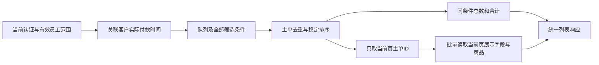

# HyperZone 列表查询性能优化方案

> 2026-11-11 更新：本文为优化前方案。用户已确认履约订单收款日期即客户付款时间，履约／备货清单跨收款单关联已取消；原文关于收款关联缓存与关联分页的建议不再适用。以本轮《HyperZone列表查询首轮优化报告.html》的实测与后续方案为准。

**编制日期：2026-11-10**

本方案基于当前 AutoFlow 代码、FOP 已导出接口契约、真实查询计时与金蝶官方 OpenAPI 资料。方案优先优化前端，其次修改 AutoFlow 对接层，最后对苍穹 FOP 做必要的小范围扩展。本文是实施建议，尚未执行这些性能改造；所有缓存时长、并发和验收指标均为建议值，不代表当前环境已达到。

## 一、推荐路线与改造边界

推荐分三层实施：前端解决重复加载及交互等待；AutoFlow 对接层解决重复扫描、详情阻塞与计数过重；FOP 解决全局付款时间筛选、排序后真正分页的问题。前两层优先，不要求立即重构苍穹业务流程。

| 方案 | 前端 | AutoFlow/Nest 对接层 | 苍穹 FOP | 能解决的核心问题 |
| --- | --- | --- | --- | --- |
| A：纯前端优先 | 请求复用、页面缓存、刷新节流、独立呈现 | 不改 | 不改 | 重复访问、页面切换；首次冷查询仍慢 |
| B：推荐近期方案 | A全部 | 请求合并、短时快照、收款复用、计数轻量投影 | 暂不改 | 大幅减少相同范围重复取数；部分首次等待可下降 |
| C：必要的后台补齐 | 延用A/B | 能力识别与协议适配 | 零代码字段/批量条件扩展；少量列表查询插件 | 首次大范围加载、正确全局排序、历史数据增长 |

后台一词在本文区分为 AutoFlow 对接层与苍穹 FOP。B方案仍是后端改动，但集中在本工程，可以避免大部分苍穹二开工作。用户已允许必要的后台调整；本轮以完整方案交付为范围。

## 二、当前能力及不能假设的能力

| 接口 | 已有契约 | 当前缺口 |
| --- | --- | --- |
| `employee-orders/page` | 员工/组织授权范围，部分队列分页；raw事实游标 | raw模式不等于业务分页；现有时间字段语义不能当作客户实际付款时间；某些队列已有上游超限 |
| `queryOrderList` | 组织、订单ID、订单编号；`pageNo/pageSize`，固定`id asc` | 当前配置不支持任意筛选、动态排序或批量ID |
| `queryOrderDetail` | 单个订单ID，完整详情，已启用数据权限 | 每笔一次；不是批量详情接口 |
| `queryReceipt` | 组织、收款单ID、收款单号；分页，固定`id asc` | 没有来源订单集合、付款时间范围或修改时间增量参数 |
| `employee-stock/orders` | 授权备货事实分页读取 | AutoFlow目前收齐授权事实后才按界面条件过滤分页 |

`queryReceipt.billno` 是收款单号，不能传履约订单号替代来源单筛选。返回体中的`filter`字段也不代表允许调用方提交任意过滤表达式。不能套用金蝶云星空的`ExecuteBillQuery`参数来调用苍穹自定义API。

苍穹操作API支持配置查询条件、数组IN、排序及返回字段，并可启用查询权限控制；这些能力需在当前服务配置并发布后才能使用，不能从平台具备能力推断本项目接口已经支持。[金蝶官方：操作API介绍](https://vip.kingdee.com/knowledge/specialDetail/272110040385964032?category=523055410186547456&id=555316763412680192&lang=zh-CN&productLineId=40&type=Knowledge)

本次测量：管理员待审核第一页11.27秒，第二页8.37秒；正常50条请求包含84次详情补查和40页收款读取；备货4.86秒；Alex近一周已完成最终26笔，却先读取4,610笔原始历史记录。详见[性能诊断](../plans/2026-11-10-workbench-query-performance.md)。这些是本地测试环境样本，不是生产P95。

## 三、前端优化方案：先做、不等待FOP改造

### 3.1 统一请求与页面缓存

建立一个工作台查询层，供列表、Dashboard、切页返回共用；使用现有Vue/Pinia即可，暂不为此引入新状态库。

- 完整缓存键包含：本地账号、FOP绑定版本、个人/部门范围、组织范围版本、队列、完成模式、全部筛选、排序、页码和每页条数。参数标准化，避免`undefined`、空串、参数次序生成多份相同缓存。
- 相同完整查询在途时复用同一个请求；Dashboard需要total时可以订阅同范围、无额外业务筛选的列表请求。不同筛选的total不得混用；pageSize=1的行结果不能冒充50条页面。
- 缓存放在会话内存，建议最多10页且受约10MB内存预算约束，采用LRU淘汰；不把含客户信息的清单写入localStorage。
- 建议待办结果有效期60秒；历史页面120秒作为初始配置。它们是可接受显示延迟的提案，严格实时场景可以缩短或关闭缓存。
- 路由与查询条件可以保留；退出、换账号、个人/部门切换、绑定/角色/组织范围变化，立即清空数据缓存、total缓存和在途结果。

缓存只复用显示数据，不能成为权限证明。新页面恢复缓存前，仍执行现有服务端范围检查；一旦权限版本不能确认、出现401/403或范围失效，隐藏缓存并重新授权。仅本地岗位检查不能证明上游逐单权限没有变化，要求逐单实时撤权的场景必须先经BFF实时校验，不能承诺完全零请求秒开。

### 3.2 利用现有100条上限做分页块缓存

这是当前无需调整FOP接口即可直接减少翻页等待的重点方案。界面继续默认50条，实际请求每块100条；收到完整响应后，仅展示对应的50条，另一半留在内存。后台已完成全局排序，前端只切片，不重新全局排序或过滤。

界面页大小S取现有20、50、100，块大小B=100。界面页p对应起点`offset=(p-1)*S`，请求后端页`floor(offset/B)+1`，块内起点`offset%B`，展示该块中从起点开始的S条。分页总数仍使用服务端total。三种页大小都整除100，不需要跨块拼接。

管理员待审核当前84笔：首次请求100条可完整覆盖两页50条界面，切到第二页直接复用同一有效数据块；备货151笔：第一页块覆盖前两页，第二块覆盖剩余51笔。仅在用户进入缺失块时请求，不预先拉完所有块。首次耗时不保证下降，但当前后端每次本已扫描完整候选集合，增加页面返回条数通常比重新执行全套查询更划算，仍须实测响应体和内存成本。

缓存键包含所有筛选和全局排序。改排序、改筛选或改范围时新建查询，不能对旧块做全局重排；不足一个队列的数据块也不能提供完整筛选候选项。后端返回total、items不完整或版本冲突时丢弃该块。缓存保持此前的权限、时效和内存约束；界面显示的业务页码与实际接口块页码分离，Excel、选中项和页码恢复都需对应回归。

### 3.3 调整自动刷新及筛选交互

建议默认待办从固定30秒改为：当前页可见且距上次成功刷新至少60秒再刷新，后台页暂停；历史已完成列表以手动刷新和过期进入触发为主。focus、visibility、online事件共用一个刷新调度器，加随机抖动，避免同一时间重复请求。加载中保持一个有效任务；手动刷新使相关缓存失效，但合并连续点击，不无限并发。

已有搜索提交按钮继续保留，不把输入每一个字符都变为请求。多条件编辑由一次“查询”提交；若未来使用即时搜索，采用300～500毫秒防抖。切换部门同步清空不适用的业务员筛选，再只发一次最终请求。

首次无缓存显示骨架；同一页面正常刷新时保留原表格并显示更新时间与“更新中”，网络失败说明旧数据时间。权限失败或切换范围立即清空，不能以体验优化为由保留无权数据。审核、出库等动作提交仍要求后台重新校验最新状态，缓存不得作为执行依据。

### 3.4 Dashboard与列表分开呈现、共用数据

每个独立卡片完成后立即更新；组合采购/配货只有所有子阶段成功后才显示合计。某个慢卡片不阻塞已完成卡片；真正权限失效仍统一撤销当前快照。图表与待办保持独立。

继续优先复用工作台列表total。冷启动且无可复用清单时，仍调用同一列表接口补齐；不新增独立FOP统计请求。当前纯前端方案无法让pageSize=1自动变轻，下一节的BFF投影负责解决这一点。

不要默认预取五个工作台所有分页。先把当前页加载完成；只有接口成本已降低、用户明确翻页意图且网络空闲时，再评估最多预取相邻一页。虚拟表格、图片懒加载只能减少渲染成本，不应作为这次8～15秒接口等待的首要措施。

## 四、AutoFlow对接层优化：优先做到不改苍穹

### 4.1 同请求合并与短时复用

在真实身份、公司、授权范围及版本一致的前提下，合并相同的在途FOP读取。初始可采用单实例有界内存；只有实际多副本部署需要共享结果时再引入共享缓存，避免无必要的新基础设施。

分开维护三类对象：完整业务候选快照、收款关联索引、订单展示详情。收款索引建议先使用30秒TTL，列表完整快照30～60秒；缓存命中前后仍保留现有权限/绑定/本地范围复验。无可靠上游撤权版本或逐单复验方式时，不跨请求复用涉及逐单授权的结果，只合并当次在途读取；待补齐版本或复验能力后启用更强缓存。

完整快照可以在同一短时视图内支持切页及合计，不必每页重扫FOP。快照必须确实覆盖整个对应候选集合；某次关键词筛选后的部分结果不能充当全队列缓存。只能在与现有服务匹配逻辑一致的范围内本地重筛选；否则用独立缓存键重新查询。

手动刷新、本系统业务操作、绑定/组织变化使相关快照失效。FOP外部操作当前没有已验证的事件通知，不能声称会立即失效，暂由TTL与显式刷新控制时效。后续若接入事件，仍保留周期校验。

### 4.2 同一列表接口提供轻量计数投影

建议新增可选参数`projection=rows|summary`，默认`rows`保留现有兼容；`summary`仍是原工作台列表接口，返回相同业务口径的total，但items为空。浏览器不直接调用苍穹，也不新增单独的FOP统计接口。

对于“未附加业务筛选、队列定义与上游已验证一致”的待审核等白名单场景，对接层调用原FOP列表接口第一页，复用其total，省去展示详情补齐和与计数无关的收款扫描。必须先验证上游已按同一身份、有效范围、阶段、取消规则统计；完整回显员工范围，不能以当前页过滤修正上游total。

以下情况不得走这个快速路径：付款时间或国家等条件只在AutoFlow后处理、队列尚未接通、上游total与本地队列口径不一致、组合卡片缺少子阶段。此时复用完整有效快照，或按原有正确路径计算，失败返回明确状态，不能填0或残缺总数。

普通列表的`rows`和Dashboard的`summary`应共用同一队列规则与缓存版本；不得开发两套互相漂移的计数逻辑。`projection`是建议新增能力，目前接口没有实现。

### 4.3 减少展示字段阻塞

同一次请求中，首次候选页确认非空且授权有效后，可以将收款索引读取与剩余必要详情补齐并行，使用统一并发预算；目前二者顺序执行。此项不降低总请求数，但可以缩短关键路径。

收件地址详情可按展开时读取，当前页的商品图片可按展示需要补充；但国家筛选、全局国家候选项现在依赖详情，未经补齐列表字段或独立正确的候选集合，不能把所有详情一律移到分页后。优先复用现有返回字段，避免为已经具备的字段再查详情。没有明确版本/modifytime时，详情缓存应短时且按授权隔离。

### 4.4 取消、预算与监控

浏览器切换查询时中止旧请求；BFF将取消传播到尚未发出的FOP批次和可取消的HTTP请求。共享查询只有所有订阅者都取消时才终止，避免一个组件退出影响另一个组件。统一整条请求的总预算，不能每个阶段重新获得90秒。

复用目前服务端令牌缓存和单次刷新逻辑，不把appSecret或FOP token下发浏览器。并发初始保持当前约4个子请求级别，并在应用/身份层增加总体预算；这只是建议起点，不是苍穹通用限额。按现场平台配置与实测调整，不能给每个用户都无限开4路。[金蝶官方：OpenAPI调用流程](https://vip.kingdee.com/knowledge/specialDetail/272110040385964032?category=523054365351886592&id=543448746756000256&lang=zh-CN&productLineId=40&type=Knowledge)

记录BFF耗时、FOP调用次数、每类接口耗时、缓存命中、限流、返回字节与失败分类；不记录token或整单客户信息。苍穹有API日志、统计及限流配置，应与BFF指标对照定位；具体配额和限流返回行为以当前租户配置为准。[金蝶官方：OpenAPI新手指引](https://developer.kingdee.com/knowledge/386485262278647808?isKnowledge=2&lang=zh-CN&productLineId=29)

## 五、必须后台补齐时，怎样把改造做小

### 5.1 优先零代码配置扩展

尽量在已有业务对象上发布兼容的轻量查询版本，保留旧API，不直接破坏其他调用方。

| 建议能力 | 最小调整 | 用途与边界 |
| --- | --- | --- |
| 订单列表轻量字段 | 返回订单ID/编号、状态、归属、国家、必要SKU展示字段及修改版本；只保留页面需要字段 | 消除整队列逐单详情补查。涉及筛选/排序的字段不能延迟 |
| 批量订单读取 | 增加`ids`数组IN筛选，建议每批不超过已验证的100个 | 当前页或授权候选补充；仍做逐单组织/数据权限检查 |
| 收款关联轻量查询 | 增加来源类型与`sourceOrderNumbers`数组、精简实收金额/成功与作废状态/实际时间/关联键 | 不再扫描所有收款；收款自身billno不等于来源订单号 |
| 增量候选能力 | 修改时间范围和稳定主键续读；输出作废、取消、关联变化所需字段 | 后续确实需要增量同步时启用，不作为一期硬依赖 |

数组IN、选择字段、固定排序等优先在操作API中配置；分录组合条件必须保证来源类型与来源单号命中同一分录。返回涉及一对多分录时，以主单去重后计数分页，再批量加载当页完整所需分录，不因SKU命中截掉整单商品。若零代码配置不能正确表达这些语义，就用一个小型查询插件，不硬凑条件。

以上扩展仍不能单独解决“按客户实际付款时间全局排序”。先取订单第1页，再补付款时间并局部排序，只能改变这一页顺序，不能保证最先付款的订单没有落在其他页。

### 5.2 真正分页的最小查询插件

推荐在既有`employee-orders/page`和备货读取能力上新增版本化的“列表模式”，保留raw模式用于诊断或受控同步。优先复用现有授权与队列规则，只替换取数管线，不重写审核、收款或采购业务流程。

查询管线为：

付款时间由明确公司＋来源类型＋来源订单键关联成功收款，按现有业务口径处理正实收、作废、退款、缺失值和UTC+8。多条收款先按订单聚合为一行，避免一对多关联把订单总数/金额放大。缺少实际金额或时间的情况保留当前未知语义，不能简单MAX历史已知时间掩盖缺失。

优先采用受权限约束的查询关联／聚合；FOP内部直接使用平台查询能力，不从Java插件再逐单HTTP调用自己的OpenAPI。数据量达到联查瓶颈后，才考虑独立付款时间查询投影：维护新增、修改、作废、退款、删除及关联变更；一次性回填、定期对账，最新记录撤销时重新计算，不能只追加取MAX。先评估执行计划和平台支持的索引配置，再决定是否需要投影，避免一开始维护第二套全量订单库。

自定义API是苍穹用于复杂集成逻辑的官方扩展方式，可以将必要逻辑集中在小范围查询服务中。[金蝶官方：自定义API（Java插件）](https://vip.kingdee.com/knowledge/294499338368404736)

建议接口契约新增内容（不是当前已实现字段）：

| 输入/输出 | 语义 |
| --- | --- |
| `paymentTimeBasis=customer_actual` | 明确时间口径，避免沿用旧字段名称但语义不同 |
| `paidFrom/paidTo` | 明确时区，范围使用左闭右开；业务近一周按已确认规则转换 |
| `sortBy/sortOrder` | 白名单字段；付款时间排序追加订单ID作为稳定次序，null位置明确 |
| `page/pageSize` | 保留现有页码交互，默认50，上限按当前100能力控制 |
| `cursor` | 大范围连续浏览/导出可选；绑定筛选、排序、范围，不与page混用 |
| `items/total/totals/asOf` | 同一个查询口径、订单级统计；保留分币种合计 |
| `snapshotId/scopeVersion` | 如提供，代表真正短时快照与权限范围版本；失效明确要求刷新 |
| `capabilities/schemaVersion` | 声明客户实际付款时间分页、批量字段等能力，客户端不得猜测 |

仅添加`asOf`或稳定排序不能提供快照隔离。界面分页若要求跨页绝不重复/漏单，需要真正固定结果快照或明确失效刷新；游标也不能独自解决排序字段被修改的问题。常规列表可保留页码；大范围导出使用绑定授权的固定清单或快照游标，并重新校验导出权限，不能后台无限循环网页分页。

### 5.3 苍穹落地检查

- 当前服务配置了什么条件，就只能依赖什么条件；新增参数、排序和出参必须导出新契约并实测。
- 原始事实模式仅按主键续读，并不等于已按业务条件排序分页；不能返回前100条原始记录就声称是完整待办第一页。
- 开启并验证操作API的数据权限控制；Java自定义查询显式复用既有授权。`scopeRole`、员工ID等只允许服务端根据登录人推导，不可扩大FOP授权。
- 两种分页响应统一映射：零代码`pageNo/rows/totalCount`与当前自定义`page/items/total`分别校验，ID全程字符串。
- 保留HTTP状态与业务`status/errorCode`双重判断。防重复请求开关不是结果缓存，也不是客户端请求合并；应核对其与自动刷新的兼容性。
- 页大小、并发、Token有效期和网关限流不能硬套其他产品的通用数值，按当前苍穹版本、应用策略及返回值配置。

## 六、实施顺序与验收

| 阶段 | 交付 | 苍穹改动 | 验收重点 |
| --- | --- | --- | --- |
| 1：前端先行 | 100条分页块缓存、在途复用、刷新调度、卡片独立呈现 | 无 | 同条件不重复请求；范围切换无旧数据；总数不受筛选污染 |
| 2：对接层降本 | 权限安全的短时复用、轻量summary、并行关键路径、取消与计时 | 无 | 重复翻页/刷新减少上游调用；summary与rows总数严格一致 |
| 3：配置补齐 | 列表必要字段、批量ID、按来源订单查询收款 | 优先零代码 | 不逐单补整队列；关联精确、分录不放大统计 |
| 4：只补必要列表模式 | 付款时间聚合后筛选排序分页，修复大范围超限路径 | 小范围Java | 首次查询不随全部历史页数线性增长 |

建议将“当前页缓存绘制小于200毫秒”和“常规冷列表P95约2～3秒”作为后续优化目标，前者不包含权限复验等待，后者需在约定网络、数据规模和并发下验证，不能现在承诺已能实现。更可靠的一期验收指标是：普通列表不再逐单请求整个队列；Dashboard轻量计数不读取展示详情；一次请求只输出当页必要行；重复访问不重复扫描40页收款。

回归必须覆盖：管理员／经理个人／经理部门／普通业务员；空范围；同一秒付款的稳定次序；多次收款、退款/作废与缺时间；SKU命中仍返回整单；国家/仓库筛选；多币种金额；第一页、第二页与导出一致；多页面并发、请求取消、外部FOP更新及权限撤销。大范围已完成和待履约上游超限必须单独验收，不能用小账号成功代替。

不建议为追求表面速度改变实际付款时间口径、只在当前页筛选/排序、把第一页条数当total，或让浏览器直接读取全量FOP数据。近期采用A+B最省苍穹改造；要同时保证大范围首次加载快、完整统计与正确全局排序，则按测量结果补齐C中的必要能力。
